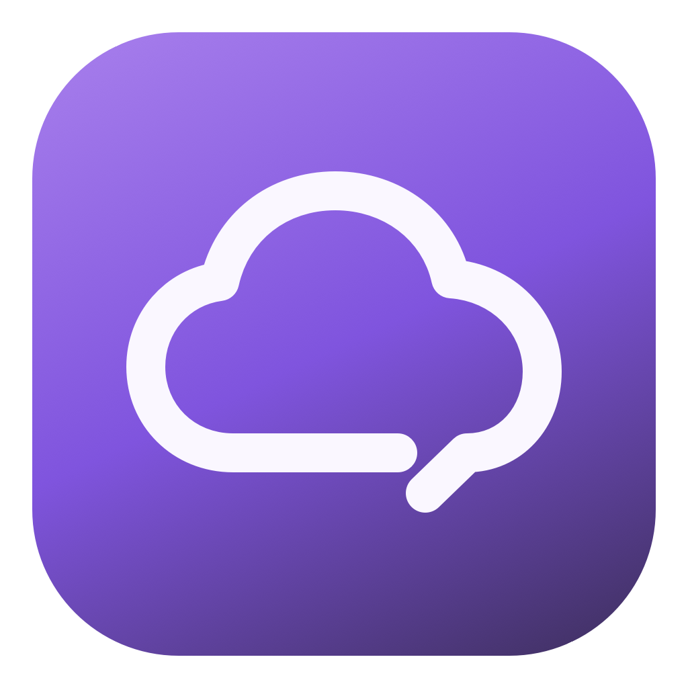
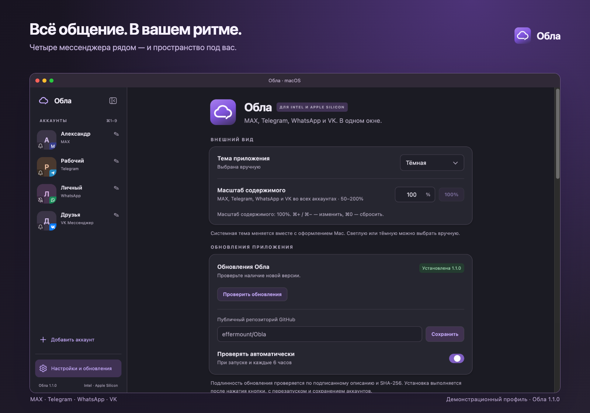
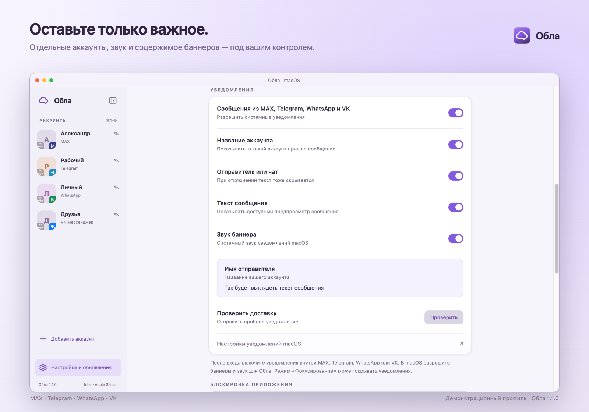
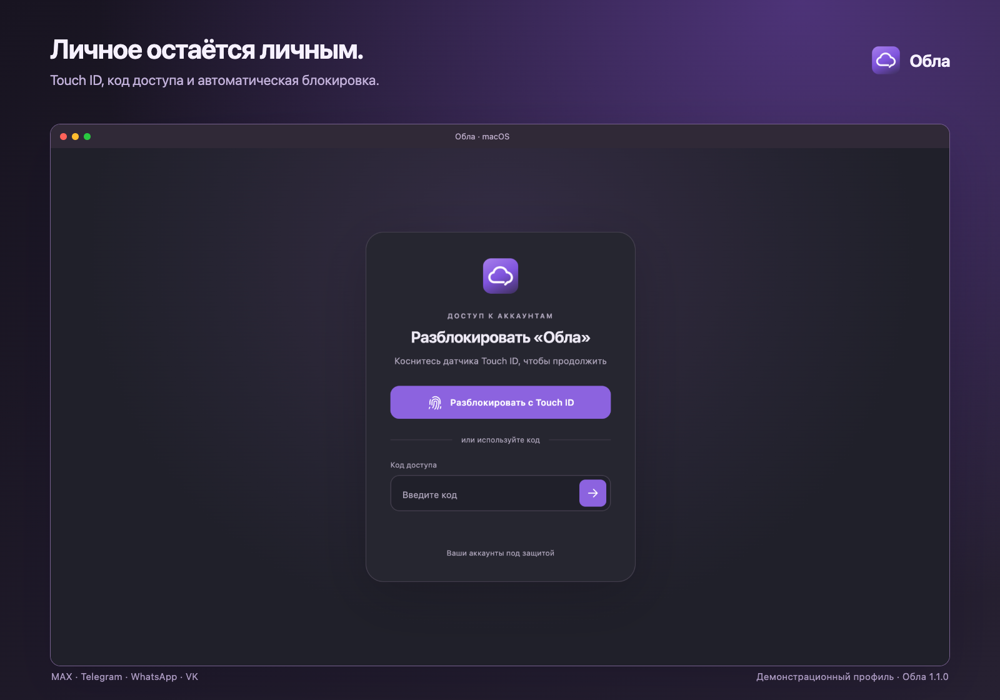

  

<h1 align="center">Обла</h1>

<strong>Четыре мессенджера. Одно спокойное пространство.</strong>

MAX · Telegram · WhatsApp · VK

macOS · Windows · Открытый код · <a href="LICENSE">MIT</a>

**Обла** объединяет официальные веб-версии MAX, Telegram, WhatsApp и VK в одном приложении для компьютера. Рабочие и личные аккаунты находятся рядом, а их авторизации хранятся отдельно.

Переключайтесь между аккаунтами, оставляйте только нужные уведомления и оформляйте рабочее пространство под себя. Без отдельной регистрации в Обла — входите в привычные мессенджеры.

<a href="https://github.com/effermount/Obla/releases/latest"><strong>Скачать Обла →</strong></a> · <a href="https://github.com/effermount/Obla/issues">Сообщить об ошибке или предложить идею</a>

  

## Скачать

| Система | Сборка | Установка |
|---|---|---|
| **macOS 13+** | Одна Universal-сборка для Intel и Apple Silicon | [Скачать DMG](https://github.com/effermount/Obla/releases/download/v1.1.0/Obla-1.1.0-universal.dmg) |
| **Windows 10/11** | x64 | [Скачать установщик EXE](https://github.com/effermount/Obla/releases/download/v1.1.0/Obla-1.1.0-windows-x64.exe) |

Для Windows также доступен [ZIP без установки](https://github.com/effermount/Obla/releases/download/v1.1.0/Obla-1.1.0-windows-x64.zip). Распакуйте весь архив и откройте `Obla.exe`. Для системных уведомлений предпочтителен установщик: он создаёт ярлыки Windows.

На Mac откройте DMG и перетащите Обла в «Программы». Браузер и Node.js уже включены в приложение.

> [!TIP]
> **macOS не даёт открыть «Обла»?** После попытки запуска откройте **Системные настройки → Конфиденциальность и безопасность → «Всё равно открыть»** и подтвердите действие. Это бесплатно. [Пошаговая инструкция по установке на Mac](docs/INSTALL_MACOS.md).

> [!NOTE]
> **Новая точка отсчёта — 1.1.0 от 26 ноября 2026 года.** Если вы пользовались прежними сборками, установите этот выпуск вручную один раз. При установке поверх прежнего приложения пользовательский профиль сохраняется. Дальнейшие обновления приходят из приложения.

## Всё нужное для общения

| Возможность | Как это работает |
|---|---|
| **Несколько аккаунтов** | Добавляйте рабочие и личные профили разных мессенджеров. У каждого — отдельная сессия. |
| **Удобная боковая панель** | Сворачивайте её до иконок, меняйте порядок перетаскиванием и задавайте свои названия аккаунтов. |
| **Уведомления под контролем** | Отключайте отдельные аккаунты, выбирайте звук и состав баннера: аккаунт, отправитель, текст сообщения. |
| **Ваше оформление** | Системная, светлая или тёмная тема; масштаб содержимого мессенджеров от 50 до 200%. |
| **Доступ под защитой** | Код, автоблокировка по бездействию и Touch ID на совместимом Mac. |
| **Обновления внутри приложения** | Проверка новых версий, загрузка с прогрессом и установка с перезапуском и сохранением аккаунтов. |

Окно можно закрыть: Обла продолжит работать в строке меню macOS или области уведомлений Windows. Полный выход — через меню приложения или значка.

## Как выглядит Обла

Настройте уведомления под себя: выберите, что показывать в баннерах, и отключите лишние аккаунты прямо в боковой панели.

Закройте доступ к аккаунтам кодом или Touch ID на совместимом Mac. Автоблокировка включается после заданного времени бездействия.

На снимках — настоящий интерфейс macOS с демонстрационными аккаунтами, без личных данных и переписок. Оформление окна в Windows отличается.

## Быстрый старт

1. Установите и откройте Обла.
2. Нажмите **«Добавить аккаунт»**, выберите мессенджер и войдите в его веб-версии.
3. Разрешите уведомления в мессенджере и настройках операционной системы.
4. Настройте тему, масштаб, баннеры и защиту в **«Настройки и обновления»**.

Переключение аккаунтов: **⌘1–9** на Mac и **Ctrl+1–9** на Windows. Название профиля можно изменить после добавления.

## Сессии и защита

Авторизация происходит в официальных веб-версиях сервисов. Сессии сохраняются в пользовательском профиле компьютера; отдельный сервер Обла для хранения переписки не используется.

Код закрывает доступ к окну приложения. Во время блокировки баннеры скрывают аккаунт, отправителя и текст. Touch ID доступен на поддерживаемых Mac, а код остаётся запасным способом входа.

Обновления загружаются из GitHub Releases. Клиент проверяет подписанное описание выпуска и SHA-256 файла; Windows и macOS используют отдельные каналы.

Публичные сборки пока не имеют Developer ID / нотариализации Apple и сертификата издателя Windows. Подпись канала обновлений — отдельный механизм проверки подлинности.

## Участие в проекте

Нашли ошибку или придумали удобную функцию? [Создайте issue](https://github.com/effermount/Obla/issues) и расскажите, что произошло, какую систему используете и что ожидали увидеть. Перед добавлением снимка экрана скройте личную переписку.

Инструкции по сборке, устройству приложения, проверкам и публикации находятся в [документации разработчика](docs/DEVELOPMENT.md).

Обла — независимый проект и не является официальным клиентом MAX, Telegram, WhatsApp или VK.

[MIT License](LICENSE)
